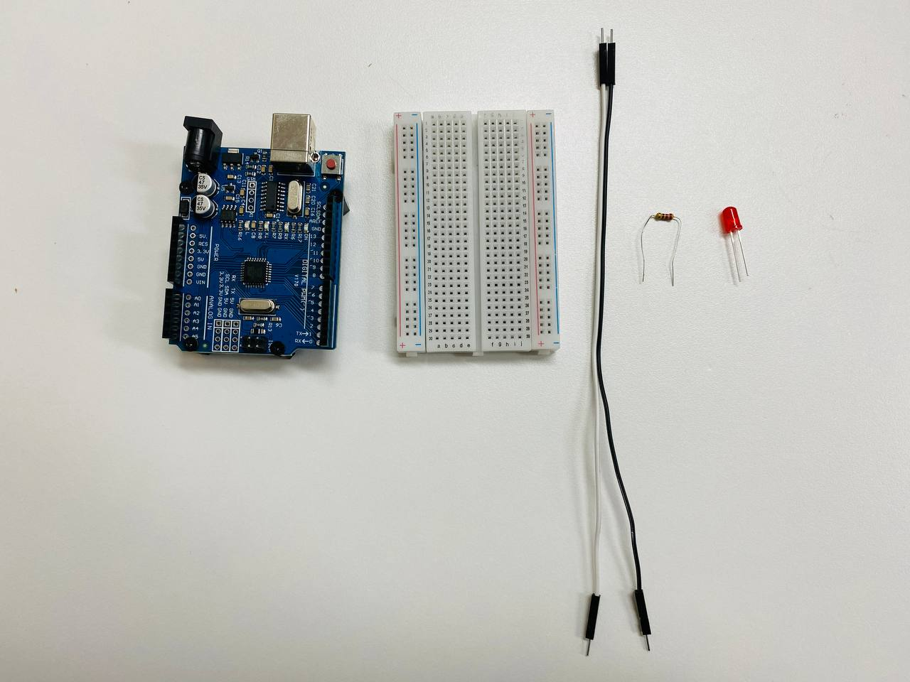
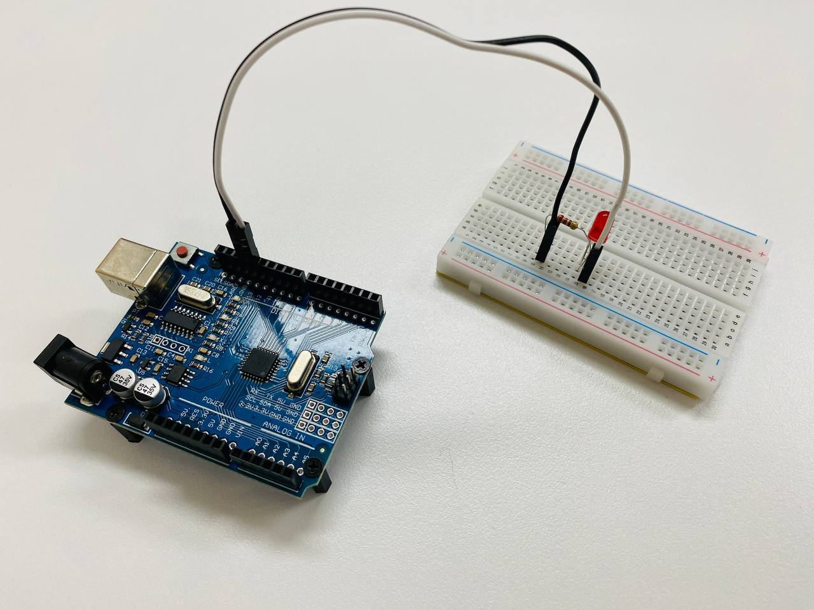
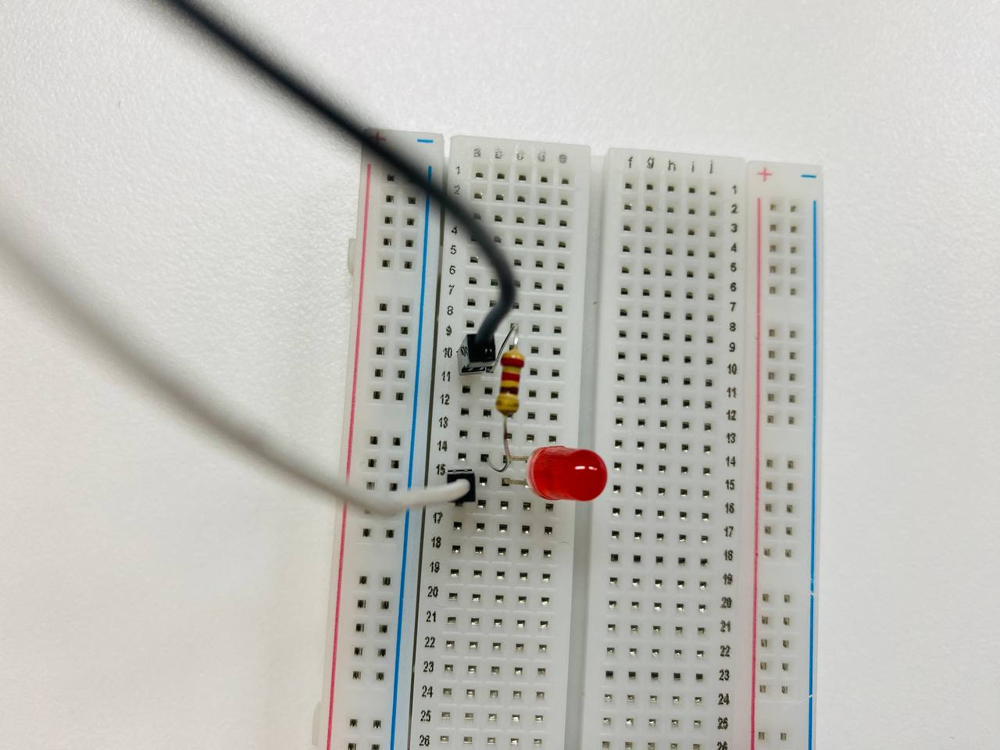
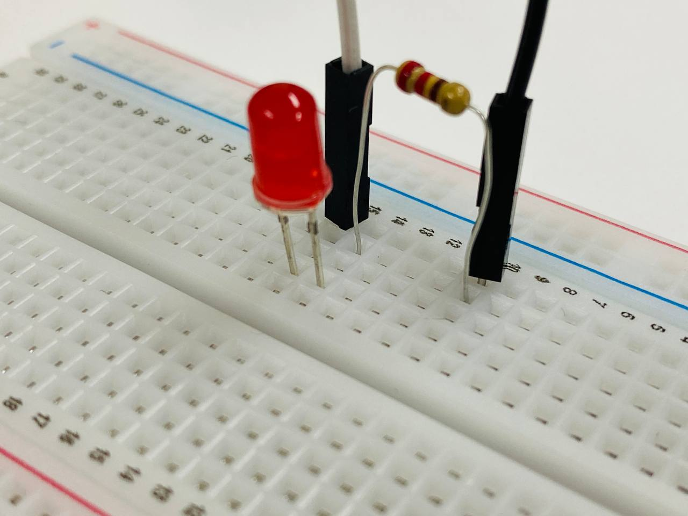
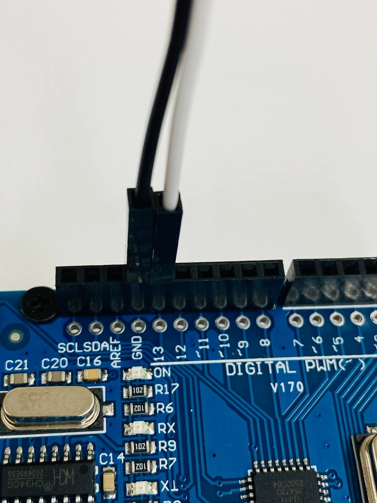

# 02-board-external-led-blinky — 외부 LED 깜빡이기

## 목적

브레드보드에 **외부 LED와 저항**를 연결하고, 아두이노 13번 핀에서 출력을 제어하여 LED를 500ms 간격으로 깜빡입니다.

## 회로

| 부품 | 수량 | 비고 |
|------|------|------|
| Arduino Uno | 1 | 13번 핀 사용 |
| 브레드보드 | 1 | |
| LED (5mm, 빨강) | 1 | |
| 저항 220Ω | 1 | |




### 배선도

```
Arduino 13핀 → 브레드보드 10 → 저항(220Ω) → 브레드보드 14 → LED 짧은 다리(-)
                                                            LED 긴 다리(+) → 브레드보드 15 → GND
Arduino GND → 브레드보드 15핀
```

> ⚠️ LED 극성(긴 다리, +)이 저항→GND 측에, 애노드(짧은 다리, -)가 13번핀 측에 와야 합니다.

## 진행 내용

### 1. 회로 구성

브레드보드에 저항과 LED를 연결합니다. LED 극성(긴 다리)이 GND 측, 애노드(짧은 다리)가 13번핀 측에 오도록 배선합니다.










### 2. 코드 업로드

PlatformIO를 이용하여 `main.cpp`를 아두이노에 업로드합니다.

```bash
platformio run -e uno --target upload
```

### 3. LED 깜빡임 확인


업로드 후 외부 LED가 0.5초 간격으로 깜빡이는 것을 확인합니다.

### 4. 코드 구조 이해

- `setup()`: `pinMode(LED_PIN, OUTPUT)` — 13번 핀을 출력 모드로 설정
- `loop()`: `digitalWrite(LED_PIN, HIGH/LOW)` + `delay(500)` — 500ms 간격으로 ON/OFF

### 5. 배선 확인

LED가 켜지지 않을 경우 다리 방향을 확인하세요. 긴 다리(+)가 GND, 짧은 다리(-)가 13번핀에 와야 합니다.

## 동작 영상


> 영상에서 외부 LED가 0.5초 간격으로 깜빡이는 것을 확인할 수 있습니다.

## 코드

```cpp
#include <Arduino.h>

const int LED_PIN = 13;

void setup() {
  pinMode(LED_PIN, OUTPUT);
}

void loop() {
  digitalWrite(LED_PIN, HIGH);
  delay(500);
  digitalWrite(LED_PIN, LOW);
  delay(500);
}
```

## 파일 구성

```
02-board-external-led-blinky/
├── src/main.cpp          # 외부 LED 깜빡이기 코드
├── platformio.ini        # PlatformIO 설정 (Uno)
└── README.md             # 이 파일
```