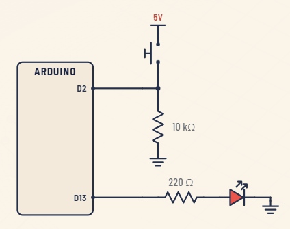
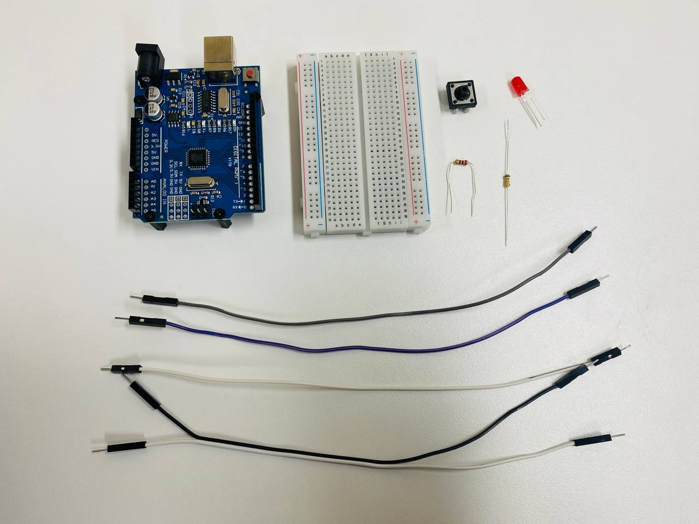
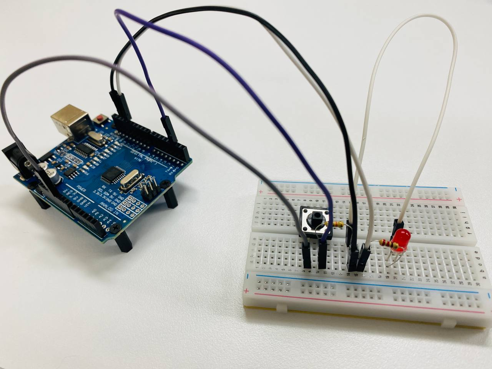

# 03-button-led — 버튼으로 LED 제어하기

## 목적

푸시버튼을 누를 때 LED가 켜지고, 뗴면 꺼지는 **디지털 입력** 제어를 학습합니다. `digitalRead()`로 버튼 상태를 읽고 `digitalWrite()`로 LED를 제어합니다.

## 회로

| 부품 | 수량 | 비고 |
|------|------|------|
| Arduino Uno | 1 | |
| 브레드보드 | 1 | |
| 푸시버튼 (택트 스위치) | 1 | 4핀 |
| LED (5mm) | 1 | |
| 저항 220Ω | 1 | LED 전류 제한용 |
| 저항 10kΩ | 1 | 버튼 풀업용 |
| 점프선 | 5 | |

### 배선도



```
[버튼 회로]
Arduino 5V ── 10kΩ 저항 ── (버튼 핀1)
                              (버튼 핀2) ── Arduino 2핀
                              (버튼 핀3) ── GND

[LED 회로]
Arduino 13핀 ── 220Ω 저항 ── LED 애노드(+) ── LED ── LED 캐소드(-) ── GND
```

> 버튼의 한 측은 5V에, 다른 측은 2번 핀에 연결됩니다. 버튼과 2번 핀 사이에 10kΩ 저항이 있습니다.

### 버튼 회로 설명

**버튼을 5V에 연결하는 이유:**

버튼을 누르지 않았을 때 2번 핀이 어떤 상태인지 명확해야 합니다. 5V에 연결하면, 버튼을 누르지 않았을 때 2번 핀이 **HIGH(1)** 가 됩니다. 버튼을 누르면 2번 핀이 **LOW(0)** 로 떨어집니다.

**10kΩ 저항을 사용하는 이유 (풀업 저항):**

버튼을 누르지 않았을 때 2번 핀이 5V에서 전류가 흐르지 않아 **떠 있는 상태(floating)** 가 되면, 아두이노가 핀 값을 임의로 읽을 수 있습니다 (노이즈 간섭 등). 10kΩ 풀업 저항을 5V와 2번 핀 사이에 연결하면, 버튼을 누르지 않았을 때 2번 핀이 5V로 **확실하게 HIGH(1)** 가 되도록 고정합니다. 버튼을 누르면 전류가 GND로 흘러 2번 핀이 **LOW(0)** 가 됩니다.

> 💡 **풀업 저항이 없으면** : 버튼을 누르지 않아도 아두이노가 HIGH와 LOW를 무작위로 읽어 LED가 깜빡이는 현상이 발생합니다.

### LED 회로 설명

**220Ω 저항을 사용하는 이유:**

LED는 전류가 너무 많이 흐르면 타버립니다. 아두이노 13번 핀은 5V(또는 3.3V) 출력이므로, LED에 직접 연결하면 과전류가 흘러 LED가 손상됩니다. 220Ω 저항을 사이에 연결하면 전류를 약 **10~20mA**로 제한하여 LED를 안전하게 사용할 수 있습니다.

> 💡 **저항이 없으면**: LED에 과전류가 흘러 LED가 타버리거나 아두이노 핀이 손상될 수 있습니다.

## 진행 내용

### 1. 부품 준비



버튼, LED, 220Ω 저항, 10kΩ 저항, 점프선을 준비합니다.

### 2. 배선



브레드보드에 버튼과 LED 회로를 구성합니다.

- **버튼**: 5V → 10kΩ 저항 → 2번 핀, 버튼 다른 측 → GND
- **LED**: 13번 핀 → 220Ω 저항 → LED → GND

### 3. 코드 업로드

```bash
platformio run -e uno --target upload
```

`main.cpp`를 아두이노에 업로드합니다.

### 4. 동작 확인

버튼을 누르면 LED가 켜지고, 뗴으면 꺼지는 것을 확인합니다.

## 동작 영상


> 영상에서 버튼을 누르고 뗄을 때 LED가 켜지고 꺼지는 것을 확인할 수 있습니다.

## 코드

```cpp
#include <Arduino.h>

const int BUTTON = 2;
const int LED = 13;

void setup() {
  pinMode(BUTTON, INPUT);
  pinMode(LED, OUTPUT);
}

void loop() {
  int pressed = digitalRead(BUTTON);
  digitalWrite(LED, pressed);
}
```

### 코드 설명

| 줄 | 설명 |
|----|------|
| `pinMode(BUTTON, INPUT)` | 2번 핀을 입력 모드로 설정 (버튼 읽기) |
| `pinMode(LED, OUTPUT)` | 13번 핀을 출력 모드로 설정 (LED 제어) |
| `digitalRead(BUTTON)` | 버튼 상태 읽기: 누름=LOW(0), 뗴음=HIGH(1) |
| `digitalWrite(LED, pressed)` | 버튼 값 그대로 LED 출력: pressed가 1이면 LED ON, 0이면 LED OFF |

> `digitalWrite(LED, pressed)`는 `pressed`가 `HIGH(1)`일 때 LED ON, `LOW(0)`일 때 LED OFF가 되도록 핀 값 그대로 전달하는 간결한 패턴입니다.

## 파일 구성

```
03-button-led/
├── src/main.cpp                        # 버튼 LED 제어 코드
├── platformio.ini                      # PlatformIO 설정 (Uno)
└── README.md                             # 이 파일
```