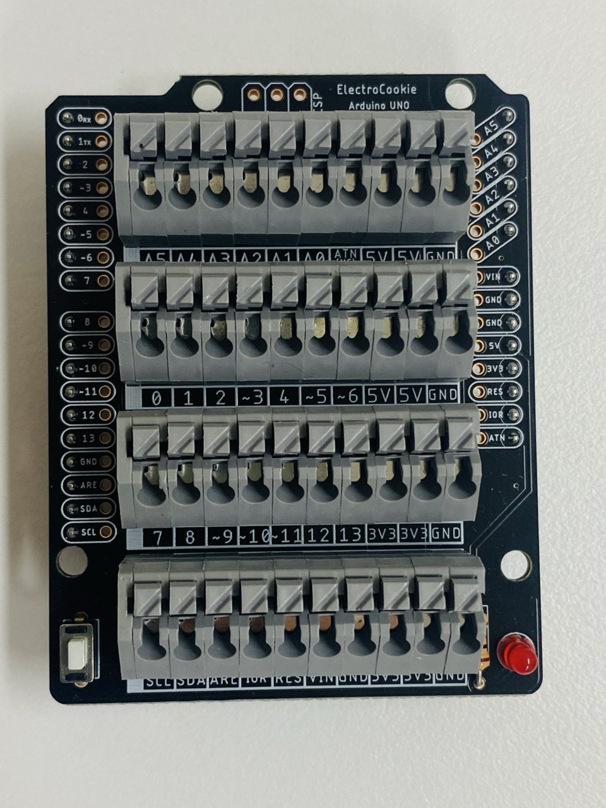
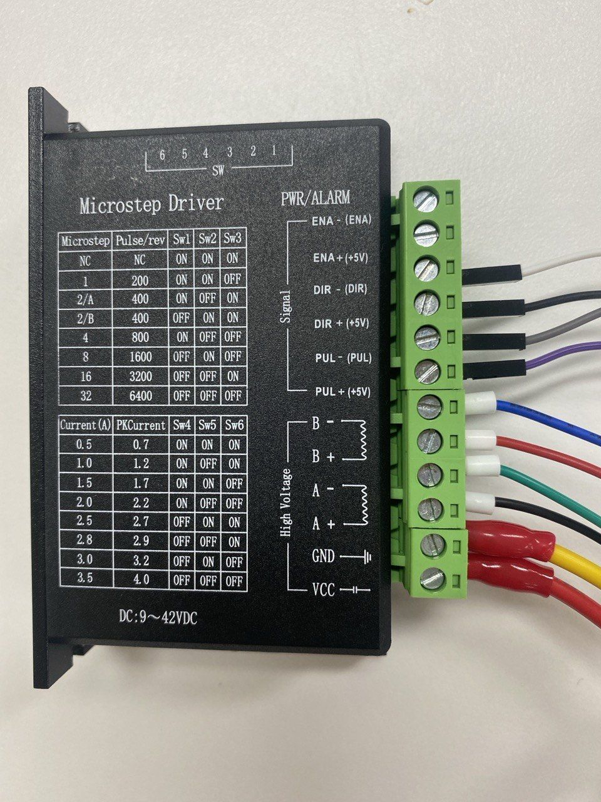
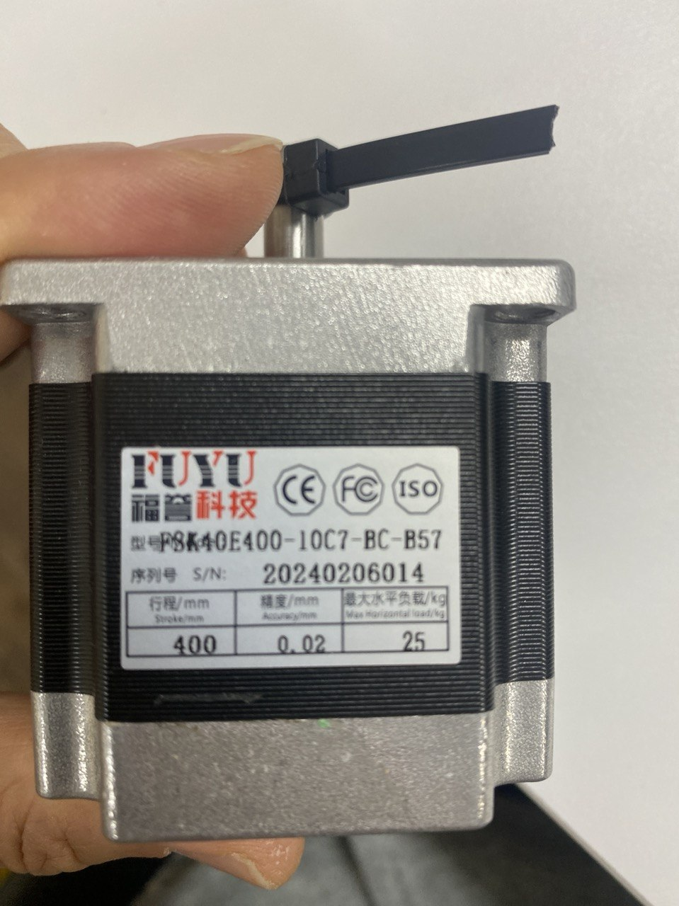
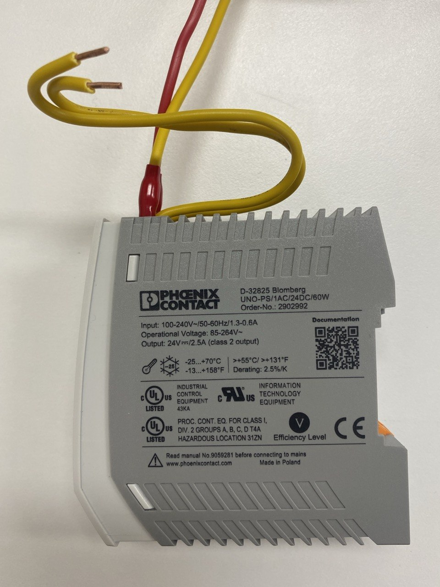
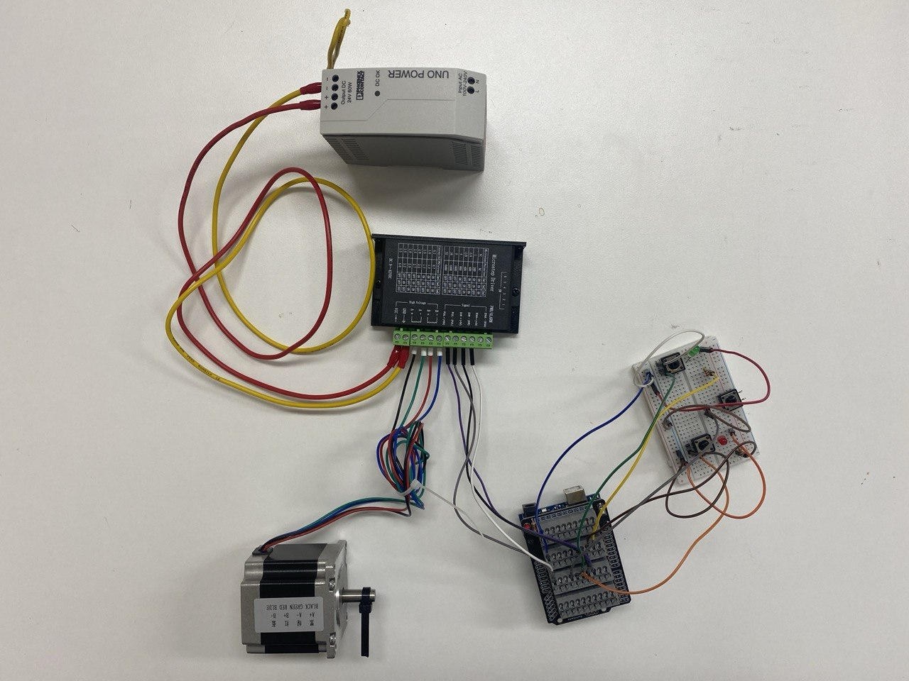
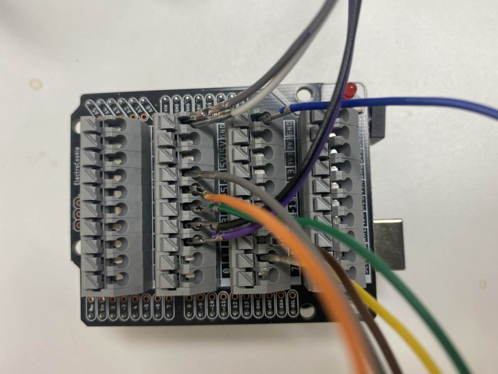
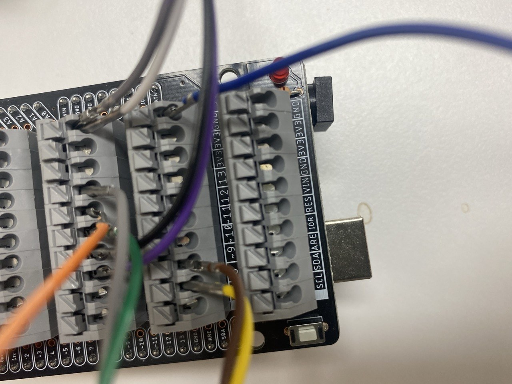
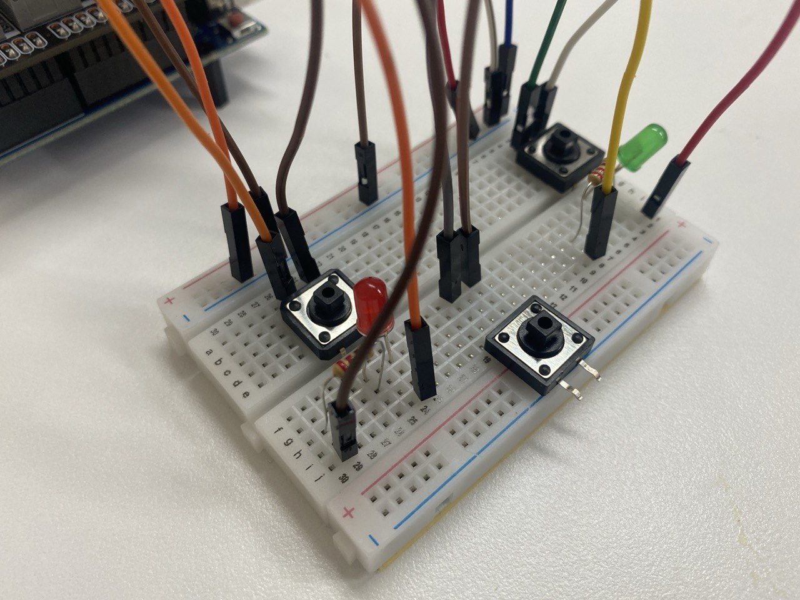
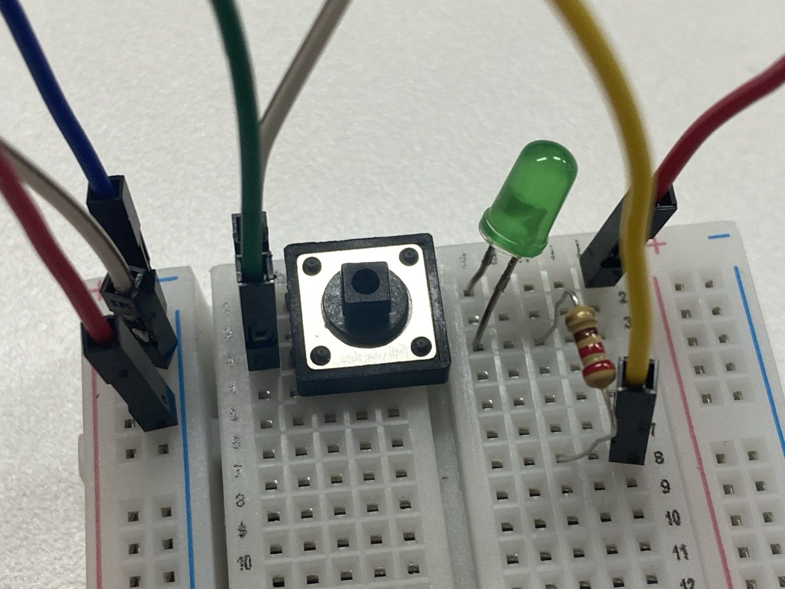
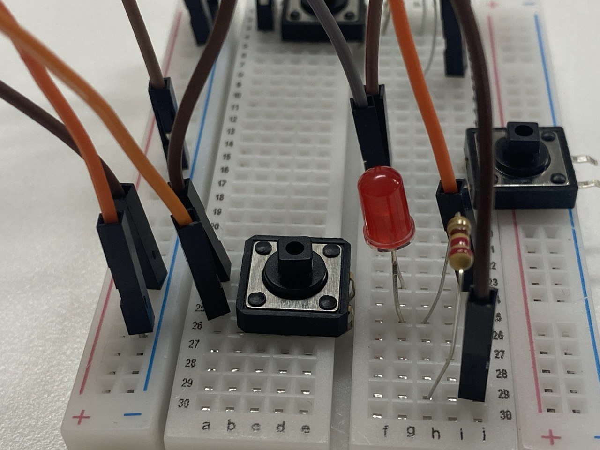

# 04-step-motor — 스텝모터 제어 (정회전/역회전/원위치)

## 목적

아두이노 쉴드와 모터 드라이브를 통해 **스텝모터**를 제어합니다. 브레드보드의 3개 버튼으로 정회전, 역회전, 원위치(홈) 동작을 수행하며, 각 동작 상태를 LED로 표시합니다.

## 사용 장비

| 장비 | 사진 | 설명 |
|------|------|------|
| Arduino Uno + 쉴드 |  | 아두이노에 모터 제어 쉴드를 부착하여 배선 |
| 모터 드라이브 |  | 24V SMTP 전원 인가, 스텝모터 구동 |
| 스텝모터 |  | FUYU FSK40E400-10C7-BC-B57 |
| SMTP |  | 220V를 24V로 변환 |

## 회로

| 부품 | 수량 | 비고 |
|------|------|------|
| Arduino Uno + 쉴드 | 1 | 모터 제어 쉴드 부착 |
| 모터 드라이브 | 1 | 24V SMTP 전원 인가 |
| 스텝모터 (FUYU FSK40E400-10C7-BC-B57) | 1 | |
| 푸시버튼 (택트 스위치) | 3 | 정회전 / 역회전 / 원위치 |
| LED (5mm, 녹색) | 1 | 정회전 표시 |
| LED (5mm, 적색) | 1 | 역회전 표시 |
| 저항 220Ω | 2 | LED 전류 제한용 |
| 브레드보드 | 1 | |
| 점프선 | 다수 | |

### 배선







```
[스텝모터 제어 신호]
Arduino 2핀(PUL) → 모터 드라이브 PUL
Arduino 3핀(DIR) → 모터 드라이브 DIR

[버튼 회로 — 3개]
정회전 버튼:  Arduino 2번핀(BTN_CW)   → 버튼 → GND
역회전 버튼:  Arduino 5번핀(BTN_CCW)  → 버튼 → GND
원위치 버튼:  Arduino 6번핀(BTN_HOME) → 버튼 → GND

[LED 회로 — 2개]
녹색 LED: Arduino 8핀 → 220Ω 저항 → LED(+) → LED(-) → GND   (정회전 시 점등)
적색 LED: Arduino 9핀 → 220Ω 저항 → LED(+) → LED(-) → GND   (역회전 시 점등)
```

### 버튼 회로 설명

**버튼을 핀과 GND 사이에 연결하는 이유:**

버튼의 한 측을 아두이노 디지털 핀(2, 5, 6번)에, 다른 측을 GND에 연결합니다. 코드에서 `INPUT_PULLUP`을 사용하여 아두이노 **내부 풀업 저항**을 활성화합니다. 버튼을 누르면 핀이 GND로 연결되어 **LOW(0)**가 되고, 뗴면 내부 풀업 저항에 의해 **HIGH(1)**가 됩니다.

> 💡 **외부 저항 불필요**: `INPUT_PULLUP` 모드를 사용하면 아두이노 내부에 약 20kΩ 풀업 저항이 활성화되어, 별도의 외부 저항(1kΩ 등) 없이도 핀 상태가 안정적으로 유지됩니다.

> 💡 **풀업 저항이 없으면**: 버튼을 누르지 않아도 핀이 떠 있는 상태(floating)가 되어 아두이노가 HIGH와 LOW를 무작위로 읽어 모터가 의도치 않게 동작하는 현상이 발생합니다.

### LED 회로 설명

**220Ω 저항을 사용하는 이유:**

LED에 전류가 너무 많이 흐르면 타버립니다. 220Ω 저항을 직렬로 연결하면 전류를 약 **10~20mA**로 제한하여 LED를 안전하게 사용할 수 있습니다.

> 💡 **저항이 없으면**: LED에 과전류가 흘러 LED가 타버리거나 아두이노 핀이 손상될 수 있습니다.

### 모터 드라이브 설명

**24V SMTP 전원을 인가하는 이유:**

스텝모터(FUYU FSK40E400-10C7-BC-B57)는 아두이노의 5V로는 구동할 수 없는 고전압·고전류 모터입니다. 모터 드라이브에 **24V SMTP** 전원을 인가하여 스텝모터를 구동합니다. 아두이노는 PUL(펄스)과 DIR(방향) 신호만 출력하고, 실제 모터 구동 전력은 모터 드라이브가 공급합니다.

> 💡 **아두이노 5V로 직접 구동 불가**: 스텝모터의 정격 전압이 24V이므로, 아두이노 핀(5V, 최대 20mA)으로는 구동할 수 없습니다. 모터 드라이브가 아두이노의 제어 신호와 모터의 전력을 분리하여 안전하게 구동합니다.

## 진행 내용

### 1. 장비 구성

아두이노에 쉴드를 부착하고, 모터 드라이브(24V SMTP)와 스텝모터(FUYU FSK40E400-10C7-BC-B57)를 연결합니다.

### 2. 배선

브레드보드에 3개 버튼(정회전/역회전/원위치)과 2개 LED(녹색/적색)를 배선합니다.

- **정회전 버튼**(BTN_CW, 4번핀): 누르면 스텝모터가 정방향(CW)으로 회전, 녹색 LED 점등
- **역회전 버튼**(BTN_CCW, 5번핀): 누르면 스텝모터가 역방향(CCW)으로 회전, 적색 LED 점등
- **원위치 버튼**(BTN_HOME, 6번핀): 누르면 스텝모터가 원점(0)으로 복귀, 녹색+적색 LED 동시 점등

### 3. 코드 업로드

```bash
platformio run -e uno --target upload
```

`main.cpp`를 아두이노에 업로드합니다.

### 4. 동작 확인

| 버튼 | 동작 | LED |
|------|------|-----|
| 정회전 (BTN_CW) | 스텝모터 정방향 회전 | 녹색 LED 점등 |
| 역회전 (BTN_CCW) | 스텝모터 역방향 회전 | 적색 LED 점등 |
| 원위치 (BTN_HOME) | 스텝모터 원점(0) 복귀 | 녹색+적색 LED 동시 점등 |
| (버튼 뗐을 때) | 감속 후 정지 | LED 소등 |

## 동작 영상


<video src="prj-04-result.MP4" controls width="80%"></video>

> 영상에서 정회전, 역회전, 원위치 버튼을 누를 때 모터가 동작하고 LED가 점등되는 것을 확인할 수 있습니다.

## 코드

```cpp
#include <Arduino.h>
#include <AccelStepper.h>

const int PUL_PIN = 2;
const int DIR_PIN = 3;

const int BTN_CW   = 4;
const int BTN_CCW  = 5;
const int BTN_HOME = 6;

const int LED_GREEN = 8;
const int LED_RED   = 9;

AccelStepper stepper(1, PUL_PIN, DIR_PIN);

const long JOG_FAR = 1000000L;

enum Mode { IDLE, JOG_CW, JOG_CCW, HOMING };
Mode mode = IDLE;

int homeIdleLevel;

void setLeds(bool green, bool red) {
  digitalWrite(LED_GREEN, green ? HIGH : LOW);
  digitalWrite(LED_RED,   red   ? HIGH : LOW);
}

void setup() {
  pinMode(BTN_CW,   INPUT_PULLUP);
  pinMode(BTN_CCW,  INPUT_PULLUP);
  pinMode(BTN_HOME, INPUT_PULLUP);

  pinMode(LED_GREEN, OUTPUT);
  pinMode(LED_RED,   OUTPUT);
  setLeds(false, false);

  stepper.setMaxSpeed(2000.0);
  stepper.setAcceleration(1000.0);
  stepper.setCurrentPosition(0);

  delay(100);
  homeIdleLevel = digitalRead(BTN_HOME);
}

void loop() {
  bool cw   = (digitalRead(BTN_CW)   == LOW);
  bool ccw  = (digitalRead(BTN_CCW)  == LOW);
  bool home = (digitalRead(BTN_HOME) != homeIdleLevel);

  if (cw && !ccw) {
    if (mode != JOG_CW) {
      mode = JOG_CW;
      stepper.moveTo(JOG_FAR);
    }
  }
  else if (ccw && !cw) {
    if (mode != JOG_CCW) {
      mode = JOG_CCW;
      stepper.moveTo(-JOG_FAR);
    }
  }
  else if (home) {
    if (mode != HOMING) {
      mode = HOMING;
      stepper.moveTo(0);
    }
  }
  else {
    if (mode == JOG_CW || mode == JOG_CCW) {
      stepper.stop();
      mode = IDLE;
    }
  }

  if (mode == HOMING && stepper.distanceToGo() == 0) {
    mode = IDLE;
  }

  switch (mode) {
    case JOG_CW:  setLeds(true,  false); break;
    case JOG_CCW: setLeds(false, true);  break;
    case HOMING:  setLeds(true,  true);  break;
    default:      setLeds(false, false); break;
  }

  stepper.run();
}
```

### 코드 설명

| 요소 | 설명 |
|------|------|
| `AccelStepper stepper(1, PUL_PIN, DIR_PIN)` | 스텝모터 제어 라이브러리, 펄스/방향 핀 지정 |
| `INPUT_PULLUP` | 버튼 핀을 내부 풀업 저항 모드로 설정 |
| `stepper.setMaxSpeed(2000.0)` | 최대 속도 2000 스텝/초 |
| `stepper.setAcceleration(1000.0)` | 가감속 1000 스텝/초² |
| `stepper.moveTo(JOG_FAR)` | 정회전: 먼 거리로 이동 (사실상 무한 회전) |
| `stepper.moveTo(-JOG_FAR)` | 역회전: 반대 방향으로 이동 |
| `stepper.moveTo(0)` | 원위치: 위치 0으로 복귀 |
| `stepper.stop()` | 버튼을 뗐을 때 감속 후 정지 |
| `stepper.run()` | 메인 루프에서 매 호출마다 모터 구동 |
| `setLeds(green, red)` | 모드에 따라 LED 상태 표시 |

> 💡 **JOG 방식**: 정회전/역회전 버튼을 누르는 동안 모터가 회전하고, 뗴면 감속 후 정지합니다. 원위치 버튼은 모터를 위치 0으로 이동시킵니다.

## 파일 구성

```
04-step-motor/
├── src/main.cpp                    # 스텝모터 제어 코드
├── platformio.ini                  # PlatformIO 설정 (AccelStepper 라이브러리)
├── prj-04-device-shield.jpg        # 아두이노 + 쉴드
├── prj-04-device-motor-drive.jpg   # 모터 드라이브
├── prj-04-device-step-motor.jpg    # 스텝모터
├── prj-04-device-smcp.jpg          # 전체 구성
├── prj-04-wiring-1.jpg             # 배선 1
├── prj-04-wiring-2.jpg             # 배선 2
├── prj-04-wiring-3.jpg             # 배선 3
├── prj-04-wiring-4.jpg             # 배선 4
├── prj-04-wiring-5.jpg             # 배선 5
├── prj-04-wiring-6.jpg             # 배선 6
├── prj-04-result.mp4               # 동작 영상
└── README.md                       # 이 파일
```